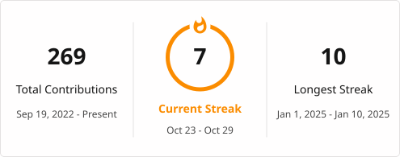

----------------------------------------------------------------------------------------------------------------------------

### Github Streak

----------------------------------------------------------------------------------------------------------------------------

### Github Stats
----------------------------------------------------------------------------------------------------------------------------

  
  

